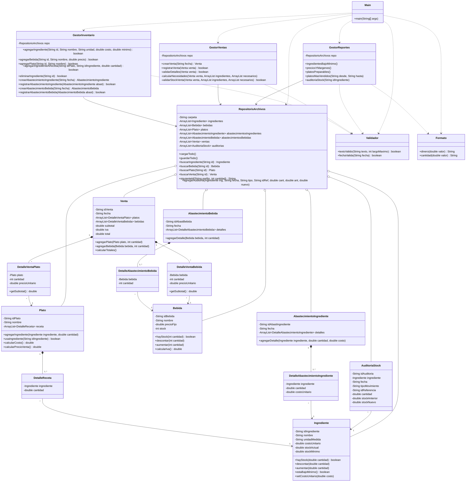

# Sistema de gestión de la cafetería UTN

Aplicación de consola en Java (programación orientada a objetos) que controla el stock de ingredientes y bebidas de la cafetería de la UTN, registra abastecimientos y ventas, y genera los reportes del administrador. La información se guarda en archivos de texto.

## Reglas de negocio

- Cada plato tiene una receta: qué ingredientes usa y en qué cantidad (kg o litros).
- El costo de un plato es la suma de los costos de los ingredientes de su receta, y su precio de venta es el doble de ese costo.
- Las bebidas tienen un precio fijo al que se le suma el IVA del 15 % en la venta. Su stock se cuenta en unidades. El IVA se aplica solo a las bebidas.
- Al vender platos se descuentan los ingredientes de la receta multiplicados por la cantidad vendida. Si falta cualquier ingrediente (o bebida), la venta completa se rechaza y el stock no se modifica.
- Cada ingrediente tiene un stock mínimo.
- No se puede eliminar un ingrediente que forma parte de alguna receta (tampoco si ya tiene abastecimientos o auditoría registrados).
- Cada abastecimiento y cada venta quedan registrados, y todo movimiento de ingredientes deja una fila en la auditoría de stock.

## Requisitos

- JDK 8 o superior (se recomienda 17). Deben estar disponibles `javac` y `java` en la terminal; se comprueba con `javac -version`.
- No usa librerías externas.

## Compilar y ejecutar

**Con el lanzador (recomendado).** Compila y ejecuta en un solo paso:

- Windows: doble clic en `CafeteriaUTN.bat`.
- Linux o Mac: `./CafeteriaUTN.sh` desde la carpeta del proyecto.

**Desde la terminal**, ubicado en la carpeta raíz del proyecto (la que contiene `src/` y `datos/`):

```
javac -d bin -sourcepath src src/Main.java
java -cp bin Main
```

(En Windows, escribir `src\Main.java`.)

Es importante ejecutar siempre desde la carpeta raíz: el programa lee y escribe la carpeta `datos/` en el directorio donde se ejecuta. Si la carpeta no existe o está vacía, el sistema inicia sin datos y la crea al guardar.

Como el programa reescribe los archivos de `datos/`, conviene conservar una copia de la carpeta original para repetir las pruebas.

## Menú principal

```
1. Registrar ingrediente
2. Registrar bebida
3. Registrar plato (con su receta)
4. Agregar ingredientes a la receta de un plato
5. Eliminar ingrediente
6. Abastecer ingredientes
7. Abastecer bebidas
8. Registrar venta
9. Reportes del administrador
10. Ver catálogo y stock
0. Salir
```

Reportes del administrador:

1. Ingredientes bajo el stock mínimo (lista de compras).
2. Costo, precio de venta y margen de cada plato.
3. Platos que se pueden preparar con el stock actual y cuántas unidades de cada uno.
4. Platos más vendidos en un período.
5. Auditoría del stock de ingredientes (movimientos y verificación contra el stock actual).

## Estructura del repositorio

```
├── CafeteriaUTN.bat            Lanzador para Windows (compila y ejecuta)
├── CafeteriaUTN.sh             Lanzador para Linux/Mac
├── src/                        Código fuente (19 clases .java)
├── datos/                      Archivos de datos (se leen al iniciar y se guardan al operar)
├── sql/cafeteria_utn_v2.sql    Script del modelo relacional para pgAdmin
├── README.md
├── .gitignore
└── .gitattributes
```

La carpeta `bin/` con las clases compiladas se genera al ejecutar el lanzador y no se sube al repositorio.

## Archivos de datos

Un archivo de texto por cada tabla del modelo relacional, un registro por línea y campos separados por `;`. Las fechas tienen formato `aaaa-mm-dd`.

| Archivo | Campos |
|---|---|
| `ingredientes.txt` | id;nombre;unidad;costo;stockActual;stockMinimo |
| `bebidas.txt` | id;nombre;precioFijo;stock |
| `platos.txt` | id;nombre |
| `recetas.txt` | idPlato;idIngrediente;cantidad |
| `abastecimientos_ingredientes.txt` | id;fecha |
| `detalle_abast_ingredientes.txt` | idAbastecimiento;idIngrediente;cantidad;costo |
| `abastecimientos_bebidas.txt` | id;fecha |
| `detalle_abast_bebidas.txt` | idAbastecimiento;idBebida;cantidad |
| `ventas.txt` | id;fecha;subtotal;iva;total |
| `detalle_venta_platos.txt` | idVenta;idPlato;cantidad;precioUnitario |
| `detalle_venta_bebidas.txt` | idVenta;idBebida;cantidad;precioUnitario |
| `auditoria_stock.txt` | id;idIngrediente;fecha;tipo;idReferencia;cantidad;stockAnterior;stockNuevo |

Los archivos de prueba incluidos son consistentes entre sí: todo el stock entró por abastecimientos y los totales de cada venta coinciden con sus detalles.

## Modelo de base de datos

El archivo `sql/cafeteria_utn_v2.sql` crea el modelo relacional en PostgreSQL (pgAdmin). Los identificadores son `VARCHAR`, las relaciones muchos a muchos se resuelven con tablas detalle y el diagrama no tiene ciclos. Las 12 tablas corresponden uno a uno con los archivos de `datos/`.

## Diagrama de clases



### Decisiones de diseño

- **Modelo y archivos:** las clases del modelo reflejan las tablas del modelo relacional. Las tablas detalle (`DetalleReceta`, `DetalleVentaPlato`, etc.) resuelven las relaciones muchos a muchos y guardan una referencia al objeto, no solo su id.
- **Datos derivados:** el costo y el precio de venta de un plato no se guardan; se calculan a partir de la receta, así nunca quedan desactualizados.
- **Precio histórico:** cada línea de venta guarda el precio unitario del momento, para que un cambio de costo no altere ventas anteriores.
- **Venta atómica:** `GestorVentas` valida todo (cantidades, recetas y stock de todos los ingredientes, sumando los que comparten varios platos) antes de descontar. Si algo falta, no se modifica nada.
- **Responsabilidades:** el modelo guarda datos y reglas simples, los gestores aplican las reglas de negocio, `RepositorioArchivos` lee y escribe los archivos y `Main` solo maneja el menú por consola.

